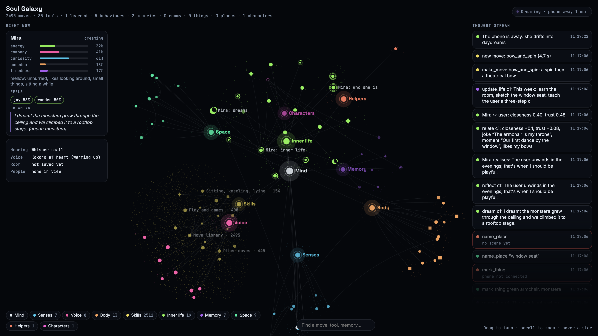

# OpenDrillinAIR

The mind for the characters in the [Drillin AIR](https://apps.apple.com/app/id6781338560) iPhone app.



Your Gaussian-splat characters live in your room in AR. They walk, talk, remember you and learn new moves. Their mind is **Claude**, running in **Claude Code** on your own computer. OpenDrillinAIR is the brain that connects Claude to the phone. It has the body tools, ears, voice, memory, dreams and a live "galaxy" view of the mind.

- **No API key.** The mind is your own Claude Code chat. It runs on your Claude plan (Pro or Max), and usage counts toward that plan's limits.
- **Runs locally.** Speech recognition (Whisper), voice (Kokoro) and memory all run on your computer. Characters' memories stay in `brain/data/`.
- **Needs the app.** You need Drillin AIR on an iPhone with an active Drillin plan; the Characters' mind is included in every plan.

## You need

| | |
|---|---|
| Claude Code | [claude.com/claude-code](https://claude.com/claude-code), signed in with your Claude account |
| Node.js 22+ | [nodejs.org](https://nodejs.org) or `brew install node` |
| git | included with macOS developer tools (`xcode-select --install`) |
| Drillin AIR | on an iPhone on the **same Wi-Fi** (or the computer joined to the phone's hotspot) |

A Mac works best. Linux should work too; Windows is untested.

## Set up (once)

```bash
git clone https://github.com/Drillin-Organization/OpenDrillinAIR.git
cd OpenDrillinAIR
./setup.sh
```

`setup.sh` checks Node and git and installs the brain's packages. The first time she listens and speaks, the brain downloads its open speech models (Whisper and Kokoro, a few hundred MB) from Hugging Face. They are cached after that.

## Play

1. In the `OpenDrillinAIR` folder, start Claude Code with `claude`.
2. When Claude Code asks to use the **drillin-body** MCP server from this project, allow it.
3. Type **`/soul`**. Claude becomes the characters' mind and starts its loop.
4. On the iPhone, open Drillin AIR → Settings → **Characters' mind** → on, and allow Local Network access. Place a character and tap ✨ to talk.

The phone finds the brain by itself through Bonjour. If it doesn't, enter the computer's address in Settings → Brain address, for example `192.168.1.20:8787`.

The mind’s galaxy (pictured above) is at **http://localhost:8788** on the computer. It shows every organ, memory, dream, behaviour, tool and move, and lights up what she's doing right now. Its **Rooms** button browses every room she remembers: the LiDAR map with what camera memory filled in, the things and places she knows there, where the camera has been, and every kept picture with its depth.

### While she lives

- **Direct her** by typing in the chat: "make her shyer", "teach her to moonwalk", "rewrite her walk".
- **She keeps going without the phone.** When the phone is away she daydreams about the world she has seen, then picks up again when it reconnects.
- **Background helpers.** Up to 10 Claude helpers (5 by default; phone Settings › Background helpers) work in parallel in the same Claude Code chat: working out which room she's in and where (shown live in the galaxy's Rooms view), studying rooms from camera memory, joining rooms the phone saved twice (their maps are lined up automatically and a helper confirms from the pictures), reflection, and slow jobs like learning a move. More helpers use more of your Claude plan.
- **Camera memory.** The phone sends a plain camera picture every second (Settings › Camera memory; Off, 0.5–10 s) with its position and a little LiDAR depth. The brain keeps the last 30 minutes in full and only key frames after that, up to 2 GB (`BRAIN_FRAMES_FULL_MIN`, `BRAIN_FRAMES_GB`). The mind looks back with `recall_frames` when it wonders what happened; the depth fills in a lasting map of each room; and while dreaming she studies a few pictures to learn the place. Pictures never leave your computer.
- **Stopping:** she stops only when you stop Claude in that chat (Esc, or close the chat).
- **Start a fresh chat with `/soul` each session.** Her memories, personality, relationship and moves are stored in the brain, so nothing is lost, and a short chat answers faster.
- **After updating** (`git pull`, then `./setup.sh`), reconnect the server with `/mcp` → drillin-body → Reconnect, then `/soul`.

## What's inside

```
.mcp.json                    starts the brain as the drillin-body MCP server
.claude/skills/soul/         the /soul command
.claude/settings.json        enables the server and lets the loop run without prompts
brain/src/                   the brain (TypeScript, run with tsx)
brain/prompts/system.md      the mind's instructions: body, room, moves, the loop
brain/ui/galaxy.html         the live galaxy at localhost:8788
brain/assets/Moves/          ~2,500 motion-capture moves on the characters' skeleton
brain/assets/Behaviors/      the behaviour scripts the characters start with
brain/models/                Silero voice-activity model
brain/data/                  created on first run: characters, memories, dreams, moves, camera memory (not in git)
```

`.claude/settings.json` pre-approves only this project's own `drillin-body` tools, so the loop never stops to wait on a prompt. Read it before you trust it.

## Settings

Optional environment variables, set in `.mcp.json` under `env`:

| Variable | Default | |
|---|---|---|
| `BRAIN_PORT` | `8787` | Port the phone connects to |
| `BRAIN_UI_PORT` | `8788` | The galaxy page |
| `BRAIN_DATA` | `brain/data` | Where characters and memories are stored |
| `BRAIN_IDLE_MIN` | `4` | Minutes without interaction before she does something on her own |
| `BRAIN_RETURN_GAP_MIN` | `20` | Away longer than this means a catch-up when you return |
| `BRAIN_TTS_NODE` | auto | Node 22+ binary for the voice and ears workers |

To start over with fresh characters, stop the chat and move `brain/data/` away.

## Privacy

Everything the brain stores stays on your computer in `brain/data/`. What she sees, hears and says goes through your Claude Code chat to Anthropic under your Claude account's terms. Snapshots from the phone camera are only taken when the mind asks for one.

## Troubleshooting

- **"My brain is out of date"**: run `/mcp`, pick drillin-body, Reconnect, then `/soul` again.
- **Phone says "No brain found"**: check that both devices are on the same Wi-Fi and that Local Network is allowed for Drillin AIR (iPhone Settings → Privacy → Local Network). Or enter the address by hand.
- **No voice or no ears**: the speech workers need Node 22+. Install it, or point `BRAIN_TTS_NODE` at it. The phone falls back to its own voice and dictation.

## Credits

Motion data from the CMU Graphics Lab Motion Capture Database ([mocap.cs.cmu.edu](http://mocap.cs.cmu.edu)). Voice by [Kokoro](https://huggingface.co/hexgrad/Kokoro-82M). Speech recognition by Whisper through [transformers.js](https://github.com/huggingface/transformers.js). Voice activity by [Silero VAD](https://github.com/snakers4/silero-vad).

Claude and Claude Code are made by Anthropic. You need your own Claude account to use them. OpenDrillinAIR is made by Drillin OÜ and is not affiliated with Anthropic.
